# Shortlist

**Stop searching. Start shortlisting.** A job search tool that watches the companies you care about, scores every opening against your real experience, and builds a tailored resume from your own words.

**Live demo:** https://erfesh.github.io/shortlist

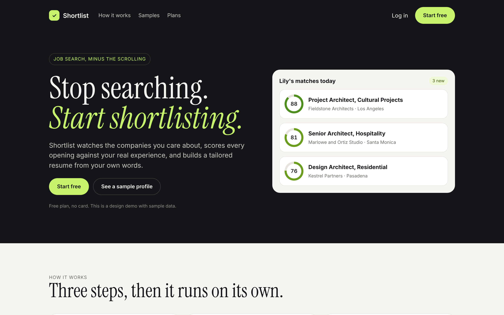

## The idea

Job hunting turns into a second job. You keep ten career pages open, read the same postings twice, guess whether you are a fit, then rewrite your resume for every role.

I built Shortlist in October 2026 for my own search. It started as a single file tool that pulled openings from a list of companies and asked AI one honest question per role: *how well does this person actually fit, requirement by requirement?* It worked well enough that I redesigned it as a product other people could use, with sign up, onboarding, sample profiles, a phone layout and paid plans.

This repo is that redesign as a working front end demo. The AI is switched off here, and everything runs in your browser with sample data.

## What it fixes

| The problem | What Shortlist does |
| --- | --- |
| Refreshing career pages one by one | Watches the companies you pick and collects new openings for you |
| Scores that are always 90% | Marks every requirement **Strong**, **Partial** or **Gap** with evidence, and caps the score when a must have is missing or the level is off |
| Generic AI resumes that invent things | Resume kits reuse your own lines, reordered for the role. If it is not on your resume, it does not go in |
| Losing track of applications | A simple tracker: Saved, Applied, Interview, Offer |
| Tools built only for tech people | Two sample profiles: Lily Cohen, an architect, and Erik Cohen, a product designer |

## Every screen

**Matches.** The short list, with an honest score and a breakdown of each requirement.

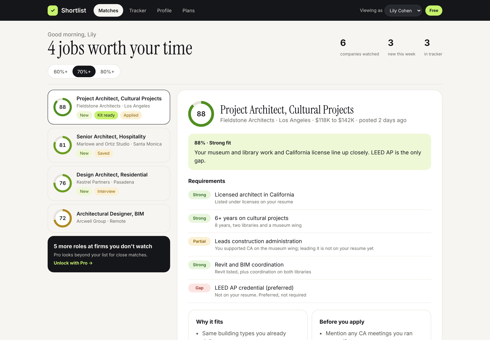

**A second profile.** Switch to Erik Cohen to see the same logic on a completely different career.

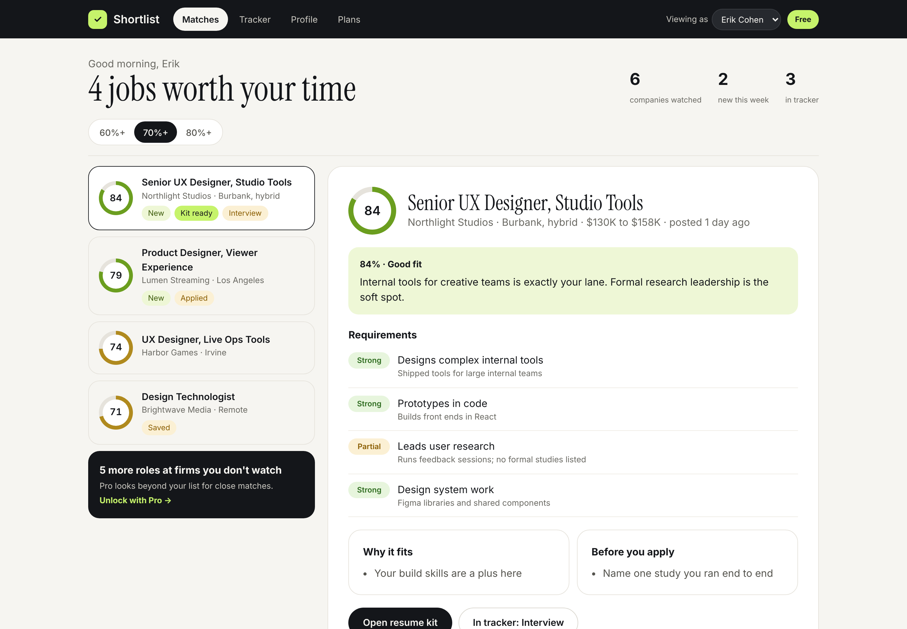

**Sign up and log in.**

| Create account | Log in |
| --- | --- |
| 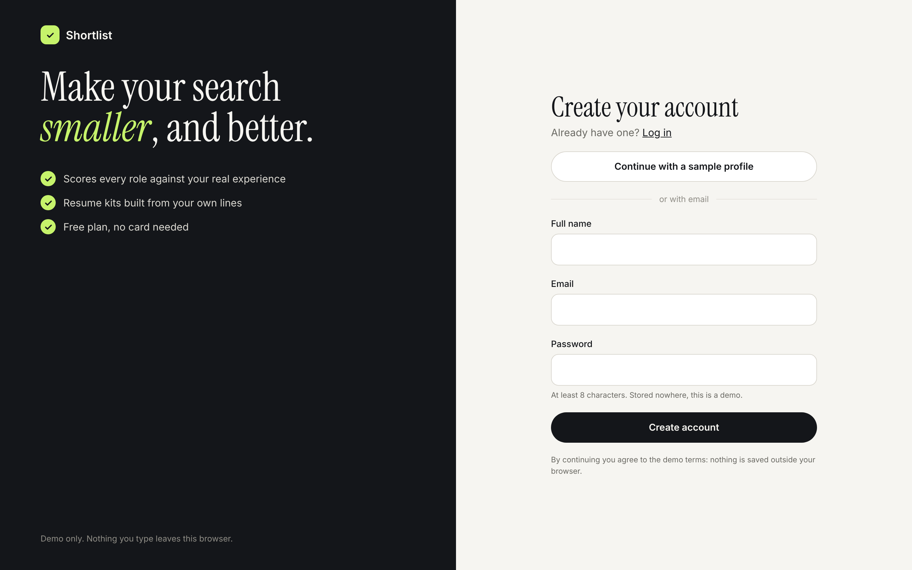 | 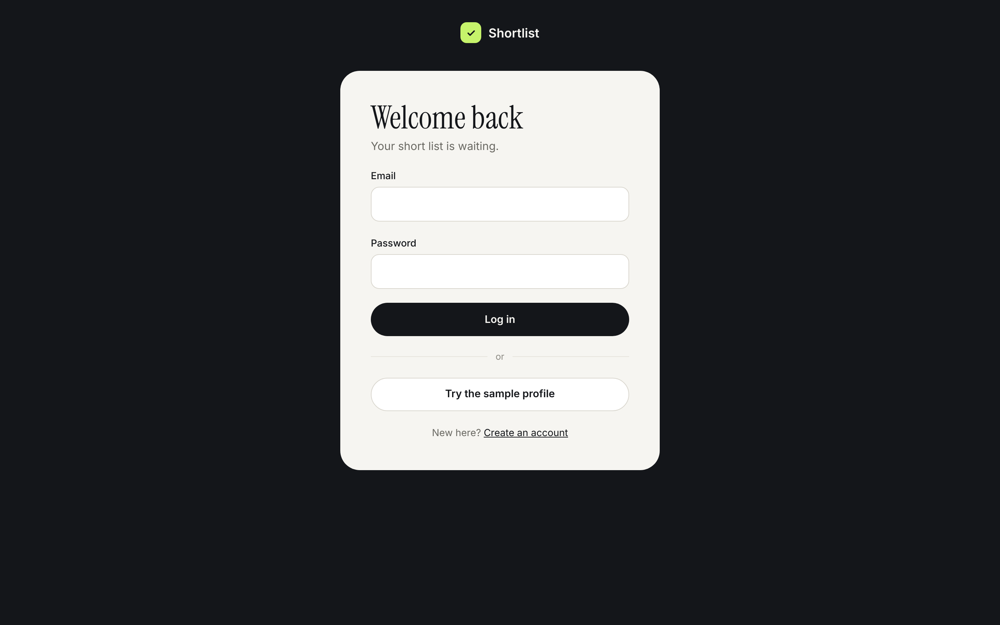 |

**Onboarding.** Three steps: resume, target roles, companies to watch.

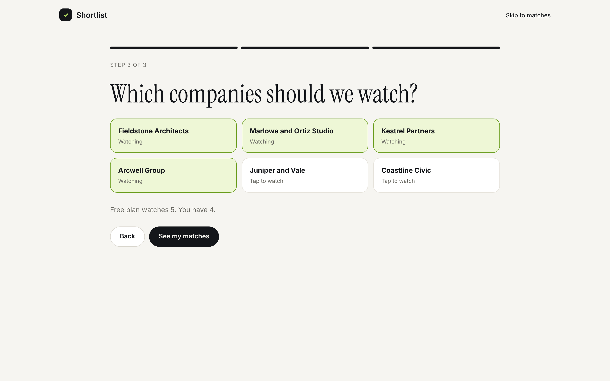

**Tracker.**

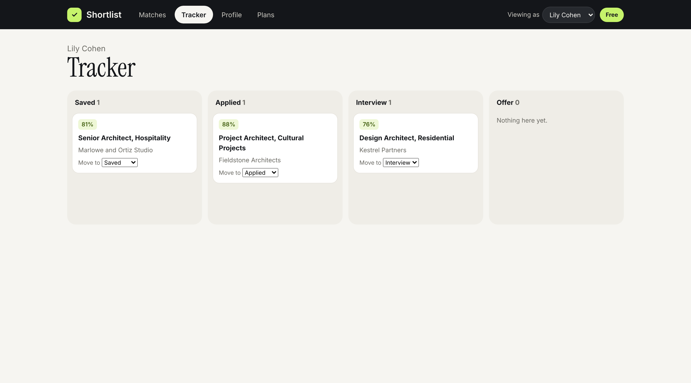

**Plans.** Free, Pro and Premium, with a monthly or yearly toggle, a 7 day trial and plain language renewal terms. Prices are a concept; the demo takes no payment.

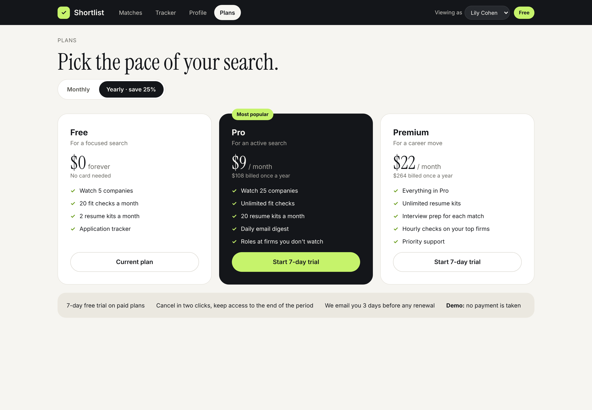

**On the phone.** Bottom tabs, a list that opens into a full screen job view, and big tap targets.

| Home | Matches | Job fit |
| --- | --- | --- |
| 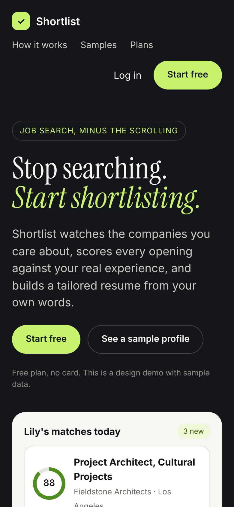 | 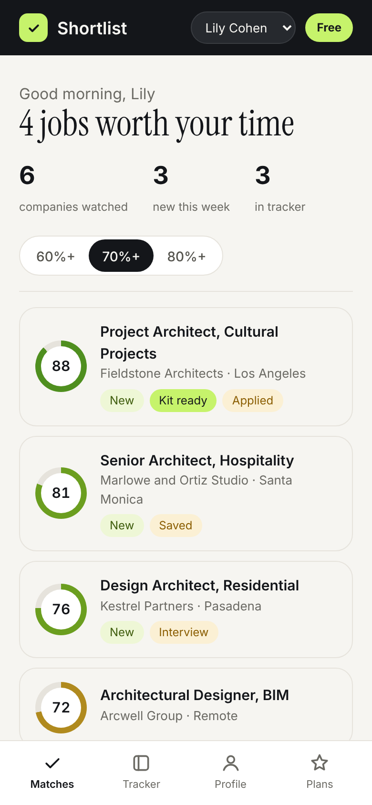 | 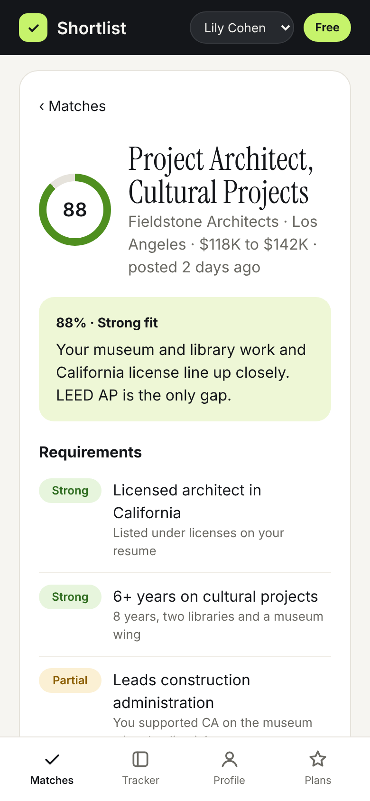 |

## How it's built

**This demo** is plain HTML, CSS and JavaScript with no build step and no dependencies.

* `index.html` loads `assets/data.js` (sample people, firms and jobs) and `assets/app.js` (a small hash router and the screens).
* State, like your tracker, chosen plan and onboarding picks, is saved in `localStorage` so the demo feels real between visits.
* One look throughout: ink `#14161a`, paper `#f6f5f1` and lime `#c6f36b`, with Inter and Instrument Serif.
* Responsive down to 320px wide, with keyboard focus styles and reduced motion support.

**The real tool**, which I use for my own search, has two versions:

* A single file app (in `tool/`) built with React that runs in the browser and calls the Gemini API for scoring and resume kits. It needs your own Gemini API key, which stays in your browser.
* A small PHP and SQLite server version that checks the watched companies every hour and sends an email digest of new strong matches.

The scoring prompt asks for a result per requirement with evidence from the resume, then applies caps: a missing hard requirement or a level mismatch holds the score down, and the reason is shown to the user.

## Run it

Open `index.html` in any browser. That is it.

Or serve the folder locally:

```bash
npx serve .
# or
python3 -m http.server 8000
```

To try the original AI tool, open `tool/index.html` and add your own Gemini API key in its settings.

## Notes

* This is a design prototype. Sign up and log in are simulated and nothing leaves your browser.
* Lily Cohen, Erik Cohen and every company and job in the demo are fictional.
* AI features are off in the demo. Plans and prices are a concept, not a live product.
* Use **Reset demo** on the Profile tab to clear what the demo saved.

---

Designed and built by **Erfan Kooshesh** · [erfesh.com](https://erfesh.com) · [LinkedIn](https://www.linkedin.com/in/erfesh)
